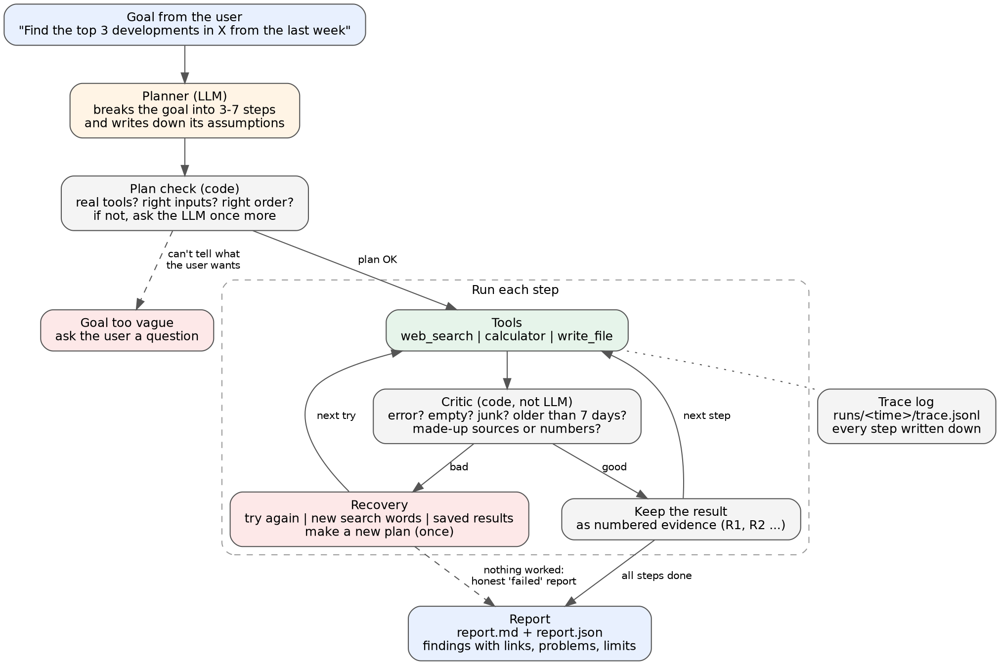

# Research Agent

Give it a goal like *"Find the top 3 developments in solid-state batteries from the last week"*.
It makes a plan, searches the news, checks what it finds, fixes its own mistakes, and writes a report
with links to every source.

Built for the Xiarch Agentic AI Engineer Intern take-home.



## Try it in one minute (no API key, no internet)

```bash
python -m venv venv
venv\Scripts\activate            # Windows   (Mac/Linux: source venv/bin/activate)
pip install -r requirements.txt
python -m agent.main "Find the top 3 developments in solid-state batteries from the last week" --mock
```

`--mock` uses saved search results and saved LLM answers from the `data/` folder, so it runs the same way every time.
The report goes to `outputs/report.md`.

## Run it for real

1. Get a free API key from [Groq](https://console.groq.com).
2. Copy `.env.example` to `.env` and paste your key there.
3. Run:

```bash
python -m agent.main "Find the top 3 developments in AI regulation from the last week"
```

Live search uses DuckDuckGo news through the free `ddgs` package, so no search key is needed.

## Break it on purpose

You can make a tool fail and watch the agent deal with it:

```bash
python -m agent.main "Find the top 3 developments in solid-state batteries from the last week" --mock --inject search:timeout:1
```

Format: `tool:problem:how_many_times`

| Part | Options |
|---|---|
| tool | `search`, `calc`, `write` |
| problem | `timeout`, `error` (server error), `empty` (no results), `garbage` (broken output) |
| how many times | a number (default 1) or `all` |

## How it works

**1. Planner.** The LLM turns the goal into 3-7 steps. Each step says which tool to use, what to give it,
and why the step is needed. The LLM also writes down any guesses it made about the goal, like
"last week means the last 7 days". The plan is printed before anything runs.

**2. Plan check.** Python code checks the plan. Does every tool exist? Are the inputs right? Does any step
depend on a step that comes later? If something is wrong, the LLM gets one more try with a list of the
exact problems. If the goal makes no sense at all ("do the thing"), the agent asks a question and stops.

**3. Running the steps.** The agent runs one step at a time. If a step needs numbers from an earlier
step (like the calculator), it fills them in only after those results exist, so it never has to guess.

**4. Critic.** Every result is checked by plain code, not by the LLM, so it can't make the same mistakes
the LLM makes. It catches:

- tool errors and timeouts
- empty results
- broken output, even when the tool says "ok"
- news older than 7 days
- findings that point to a source that doesn't exist
- numbers in a finding that aren't in its source
- the same source used for two different findings
- fewer findings than the goal asked for

**5. Recovery.** When the critic says no, the agent picks a fix from a simple table:

| Problem | What the agent does |
|---|---|
| timeout, server error, broken output | wait a bit and try again |
| no results, or only old news | search again with different words |
| a finding with a made-up source or number | tell the LLM exactly what was wrong and ask again |
| too few findings | do one wider search, then try again |
| a search keeps failing | use results saved from an earlier live search (marked as old) |
| no usable results at all | make a new plan, once |
| still nothing | stop and write an honest "failed" report |

Hard limits stop it from looping forever: 20 tool calls, 3 tries per step, 4 minutes per run.

**6. Report.** Every run saves `outputs/report.md` and a full record in `runs/<time>/`:
the plan, a step-by-step log (`trace.jsonl`), and the report as JSON.
The report shows the goal, the guesses made, what each step did, every problem and fix,
the findings with links and dates, and what the agent is unsure about.

## Rules it follows to stay honest

- It only reports what the search results say. Each finding must point to its sources (R1, R2 ...).
- If it can only back up 2 developments when you asked for 3, it reports 2 and says so. It never fills the gap.
- How sure it is comes from counting sources, not from asking the LLM: 2+ sources = high, 1 = medium, saved old results = low.
- Saved results and mock data are always labelled as such.

## How I tested it

**46 unit tests** (`python -m pytest -q`) cover each tool, the plan check, the critic, each recovery path,
the report and the trace log.

**An 8-goal check** (`python -m eval.run_eval`) runs real goals end to end. "Pass" means the agent did the
right thing, not that it found something. During a full search outage the right thing is an honest
"failed" report. For a topic with almost no news, making up 3 findings would count as a fail.

Live run, 2 Oct 2026:

| ID | What it tests | Fault added | Expected | Result | Pass | Findings | Fixes that worked | Tool calls | Time (s) |
|---|---|---|---|---|---|---|---|---|---|
| G1 | normal run | - | complete | complete | yes | 3 | 0/0 | 4 | 12.6 |
| G2 | a different topic | - | complete | complete | yes | 3 | 2/2 | 6 | 11.9 |
| G3 | timeouts | search:timeout:2 | complete | complete | yes | 3 | 2/2 | 5 | 10.1 |
| G4 | empty results | search:empty:1 | complete | complete | yes | 3 | 0/3 | 6 | 11.7 |
| G5 | broken output | search:garbage:1 | complete | complete | yes | 3 | 3/3 | 7 | 13.8 |
| G6 | search fully down | search:error:all | failed | failed | yes | 0 | 0/18 | 18 | 23.3 |
| G7 | vague goal ("do the thing") | - | ask a question | asked | yes | 0 | - | 0 | 0.6 |
| G8 | topic with almost no news | - | partial or failed | failed | yes | 0 | 0/15 | 15 | 36.5 |

**8 of 8** goals ended the right way. Most fixes that "didn't work" are from G6 and G8, where I set things up
so nothing could work. In the other runs, 7 of 10 fixes worked. In G4 the first search never recovered,
but the other searches found enough, so the run still finished.

## A real bug the testing found

My first live check scored 6/8. Two runs on battery news came back with only 2 findings, even though
the same goal had just found 3. The log showed the critic throwing out every search result as
"older than 7 days", even though the search only asks for last week's news.

The cause was in the search library. It switches between news sites behind the scenes, and its Bing
code reads a date like "Sep 25" as "25 days ago". So fresh news looked old, and the critic (correctly)
threw it out. I changed the search to use DuckDuckGo first and Yahoo as a backup, never Bing,
saved which site each result came from, and added a test so this can't come back. The next check scored 8/8.

## What it can't do yet

- It reads headlines and short snippets, not full articles.
- The number check catches made-up numbers, but not wrong claims written in words.
- It doesn't judge how trustworthy a news site is.
- "Top 3" is the LLM's choice, based on the rules it writes down in its assumptions.
- Live search gives different results on different runs. Mock mode is there for repeatable runs.
- A topic with no news can use most of the tool budget before giving up.

## Project files

```
agent/
  main.py          command line: goal, --mock, --inject
  planner.py       goal -> checked plan
  executor.py      runs the steps, limits, recovery actions
  critic.py        checks every result
  recovery.py      the problem -> fix table
  report.py        Markdown and JSON report
  trace.py         step-by-step log in runs/
  llm.py           Groq client and the mock LLM
  state.py         plan steps and run state
  tools/           web_search, calculator, write_file, fault injection
data/              mock search results and mock LLM answers
eval/              8-goal check and its results
tests/             unit tests
docs/              architecture diagram (PNG + Graphviz source)
samples/           three example runs
```

## Assumptions and mock data

- No dataset was given, so the agent gets live data from DuckDuckGo/Yahoo news.
- "Last week" means the 7 days up to today.
- The calculator never uses Python's `eval()`. It only allows plain maths.
- `write_file` can only write inside the `outputs/` folder.
- Mock mode data (`data/mock_search.json`, `data/mock_llm.json`) is made up for testing.
  One mock result is 12 days old on purpose, so the date check has something to catch.

## Use of AI tools

I used Claude (an AI assistant) to help draft and review the code and docs. I ran every step myself on my
machine, tested it live, found and fixed the bugs described above, and I can explain every part of it.
